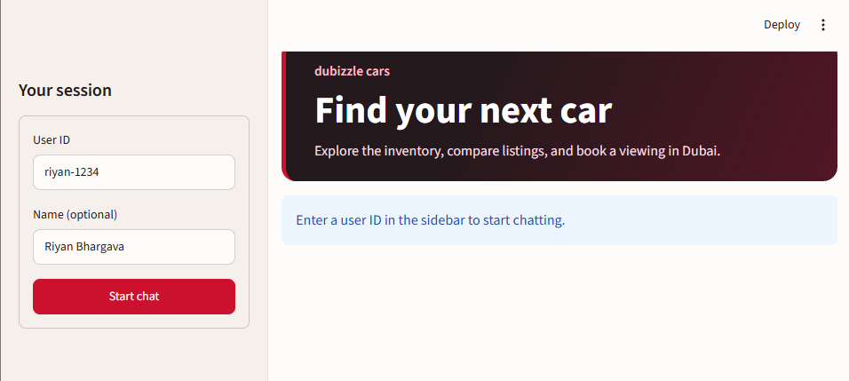
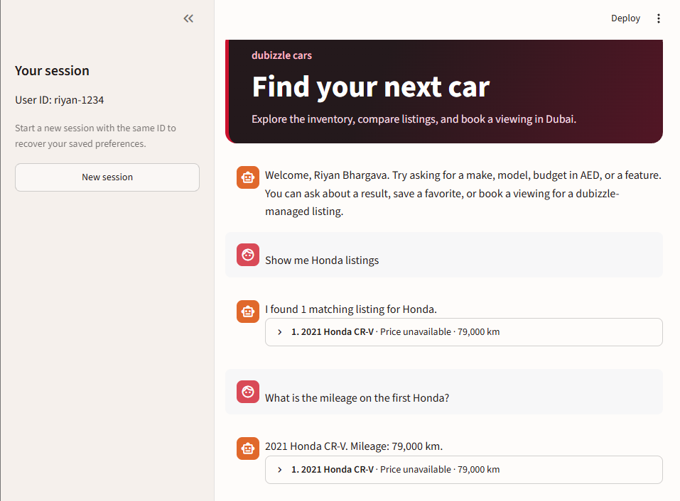
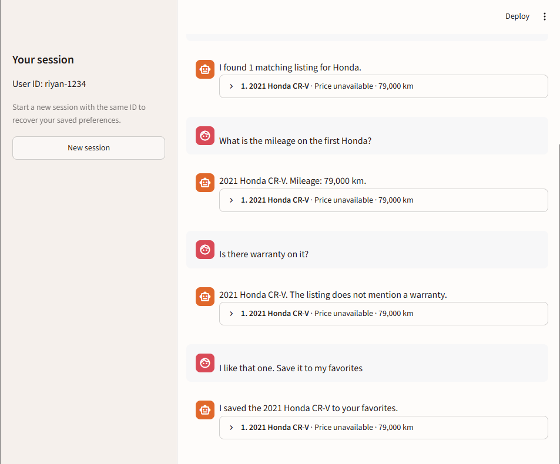
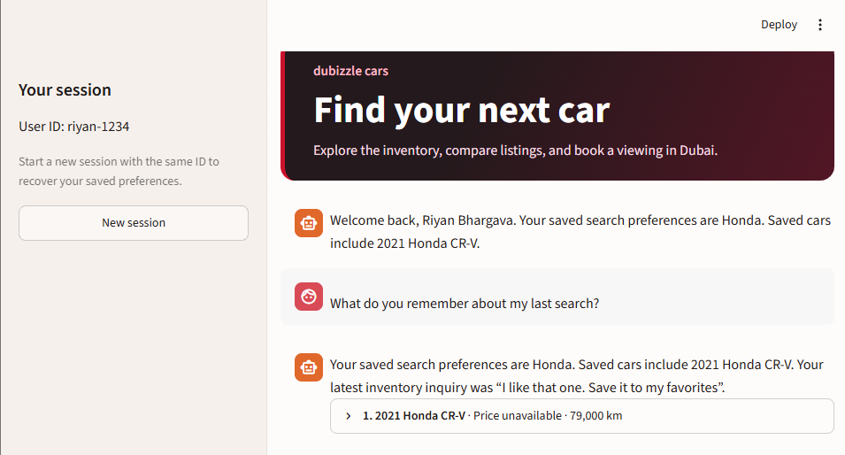
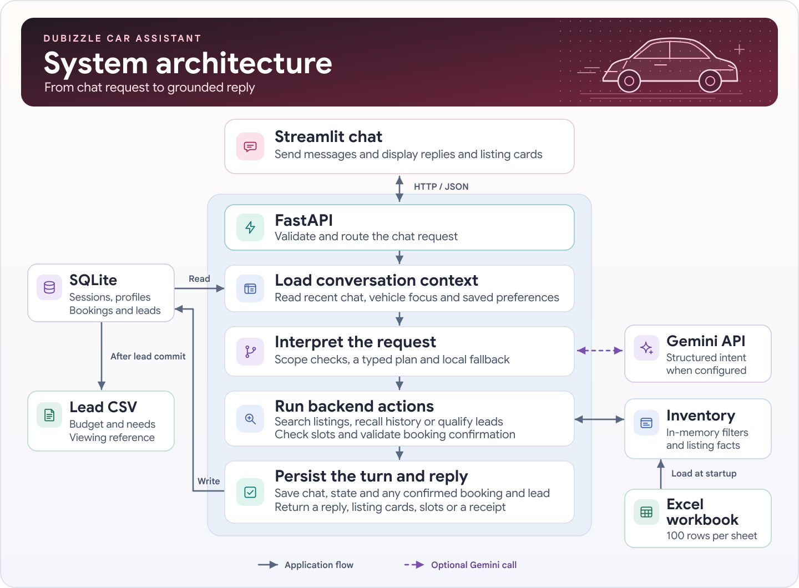

<h1 align="center">dubizzle Car Assistant</h1>

<p align="center">Explore used-car listings, pick up where you left off, and book a viewing.</p>

<p align="center">
  <a href="#quick-start">Quick start</a> ·
  <a href="#recorded-demo">Recorded demo</a> ·
  <a href="#architecture">Architecture</a> ·
  <a href="#design">Design</a> ·
  <a href="#verification">Verification</a>
</p>

## What you can do

| Capability | Try it in chat |
| --- | --- |
| Search the inventory | “Show me managed cars under AED 110,000.” |
| Ask a follow-up | “What's the mileage on the first Honda?” followed by “Is there a warranty on it?” |
| Recall an earlier conversation | Start a new session with the same user ID and ask “What car did I ask about earlier?” |
| Book a managed viewing | Pick a listing and time, share your budget and needs, then say “confirm booking.” |

## Quick start

Install [Git](https://git-scm.com/install/) and [uv](https://docs.astral.sh/uv/getting-started/installation/). The project uses Python 3.12. To install it with uv, run `uv python install 3.12`.

### 1. Clone the repository

```sh
git clone https://github.com/RiyanBhargava/take-home-assignment.git
cd take-home-assignment
```

### 2. Add the workbook and configure the app

Place the supplied `Copy_of_sample_cars_dataset.xlsx` in the cloned `take-home-assignment` folder, next to `main.py`.

Copy `.env.example` to `.env` using `Copy-Item .env.example .env` in PowerShell or `cp .env.example .env` on macOS or Linux. Set `GEMINI_API_KEY` to your key from [Google AI Studio](https://aistudio.google.com/apikey), or leave it blank to use the local interpreter.

### 3. Install dependencies and start FastAPI

From the parent folder where you ran `git clone`, enter `take-home-assignment`. If your terminal is already inside it, start at `uv sync --locked`.

```sh
cd take-home-assignment
uv sync --locked
uv run uvicorn main:app --host 127.0.0.1 --port 8000
```

Keep this terminal running. Open the [health endpoint](http://127.0.0.1:8000/health) to confirm the API loaded the inventory. The [interactive API docs](http://127.0.0.1:8000/docs) cover sessions, chat, inventory, and viewing slots.

### 4. Start Streamlit and try the app

Open a second terminal and enter `take-home-assignment` from the parent folder. If the new terminal already opens inside the clone, start at `uv run`.

```sh
cd take-home-assignment
uv run streamlit run app.py --server.address 127.0.0.1 --server.port 8501
```

Open [Streamlit](http://127.0.0.1:8501). Enter a sample user ID such as `alex-demo`, select **Start chat**, and ask **Show me Honda listings**. To try returning-user recall, select **New session**, reuse that ID, and ask **What car did I ask about earlier?**

Press `Ctrl+C` in each terminal when you want to stop the services.

## Recorded demo

### 1. Start a session

Enter a user ID and an optional name to start chatting.



### 2. Search the inventory

The Honda search finds a 2021 CR-V. Asking about the first Honda returns its recorded mileage of 79,000 km.



### 3. Follow up and save a favorite

The assistant resolves “it” to the same CR-V, reports that its listing does not mention a warranty, and saves the car as a favorite on request.



### 4. Recall preferences in a new session

After selecting **New session**, the user enters the same ID. The welcome-back message and recall reply show the earlier Honda search and saved CR-V in the fresh chat.



## Architecture

[](docs/architecture.svg)

Read the center column from top to bottom to follow a chat request. The side connections show where the backend reads or writes data and when it may call Gemini.

## Design

### Stack choices

Streamlit provides an interactive chat and a visible session reset with minimal client code. FastAPI owns the workflow. The Gemini REST API supplies typed intent and arguments in a single call when needed. An in-memory scan gives exact numeric filters and inspectable phrase matches across the 100 listings. SQLite provides durable memory and atomic reservations with no separate database service.

### Implementation

Python validates the interpreted request, resolves references against inventory records, and writes replies from those records. A local parser handles core flows if Gemini is unavailable. Session context and returning-user profiles are stored separately. Each confirmed reservation and its lead are committed together before the lead CSV is exported.

For production, I would add authenticated accounts, retention controls, live inventory and calendar integrations, and a CRM-backed lead workflow. With more inventory and evaluation data, semantic retrieval could improve matching for qualitative requests such as stroller space while preserving exact numeric filters.

### Data and booking rules

- **Inventory.** The default `raw dataset` sheet contains the Honda example and listings with managed-sale evidence. Set `INVENTORY_SHEET=cleaned dataset` to use the other 100-row sample.
- **Listing facts.** The loader extracts cash price, mileage, warranty, and managed status from available listing evidence. Monthly installments and fees are excluded. Price filters use AED and only include listings with an extractable cash price.
- **Viewings.** Managed listings offer one-hour slots Monday through Saturday in `Asia/Dubai`, with starts from 08:00 through 19:00. A separate confirmation reserves the slot. The assistant collects qualification details or accepts an explicit skip.
- **Local storage.** Profiles, sessions, and bookings live in `.runtime/assistant.sqlite3`. Leads are exported to `.runtime/leads.csv`. The workbook, credentials, and runtime data are ignored by Git.

## Verification

The tests build a small workbook and run without a Gemini key.

```sh
uv run pytest -q
uv run ruff check .
uv run ruff format --check .
```
